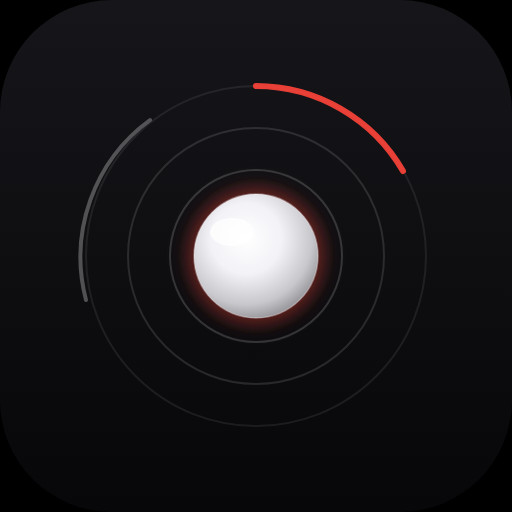

<p align="center">
  
</p>

<h1 align="center">Sentry-CD: Body-Worn Acoustic-Vision Counter-Drone Sentry</h1>

<p align="center">
  <a href="https://github.com/Sebastianrodaaa/EDTHHACK"></a>
  
  
  
  
  
  
  <a href="LICENSE"></a>
</p>

Reference implementation of **Sentry-CD**, a local counter-drone command system built for the EDTH hackathon. A body-worn microphone listens for a drone-like acoustic signature, a point-of-view vision check confirms or rejects the contact, and late fusion turns the two confidences into a threat level and an escalating recommendation. The operator confirms, escalates, or stands down. The service never engages an effector.

Sentry-CD starts from swappable sensor adapters (simulated microphone and scripted vision now; a Raspberry Pi mic and a Meta glasses feed later) and runs the full pipeline in one FastAPI process: scenario player, acoustic gate, vision worker, fusion, tracker, and a WebSocket gateway. The Expo operator app renders the live state — acoustic orb, fused meters, recommendation, tracking compass, and the server-driven reasoning trail.

In this repo the simulated end-to-end demo is the supported path. Start the gateway, launch the iOS app, then `POST /scenario/demo-alpha/start` or `POST /scenario/demo-bravo/start`. An optional laptop overlay (`vision/live_overlay.py`) can replace the scripted vision event with a live YOLO11 detection from a screen-captured POV.

This repository is published as [EDTHHACK](https://github.com/Sebastianrodaaa/EDTHHACK). The product name is Sentry-CD. Milestone v1 (all five planned phases) is in the tree: backend skeleton, vision pipeline, fusion and escalation, mobile integration, and target tracking.

## Table of Contents

- [Overview](#overview)
- [Problem](#problem)
- [Approach](#approach)
- [Results](#results)
- [Architecture](#architecture)
- [Features](#features)
- [Directory Structure](#directory-structure)
- [Requirements](#requirements)
- [Installation](#installation)
  - [1. Clone the Repository](#1-clone-the-repository)
  - [2. Backend Environment](#2-backend-environment)
  - [3. Operator App](#3-operator-app)
  - [4. Live Vision Overlay (optional)](#4-live-vision-overlay-optional)
- [Running the Demo](#running-the-demo)
- [Configuration](#configuration)
- [Scenarios](#scenarios)
- [Operator App](#operator-app)
- [Live Vision Overlay](#live-vision-overlay)
- [Customizing](#customizing)
- [Troubleshooting](#troubleshooting)
- [License](#license)

## Overview

This repo is the EDTH hackathon build of a body-worn counter-drone sentry. It provides:

- **The gateway** — a single-process FastAPI service (`backend/main.py`) that wires scenario playback, acoustic gating, vision, late fusion, tracking, escalation, and the WebSocket fan-out.
- **Two scripted engagements** — `demo-alpha` (confirmed inbound drone) and `demo-bravo` (acoustic contact that vision classifies as a bird). Both are deterministic timelines under `backend/sim/scenarios/`.
- **The operator app** — Expo SDK 56 / React Native, with a Skia acoustic orb, threat panel, tracking overlay, and reasoning trail. It subscribes to `ws://<host>:8000/ws` and posts operator actions to the REST control plane.
- **A live vision seam** — `vision/live_overlay.py` runs COCO YOLO11n and a drone YOLO11 on a screen region (or a video file) and POSTs detections to `/api/vision/detection`.
- **Smoke tests** — in-process checks for the gateway, the acoustic-to-vision cascade, fusion and human confirmation, and tracking plus false-alarm restraint.

Sensor hardware is behind adapters in `backend/adapters/`. `ACOUSTIC_ADAPTER` and `VISION_ADAPTER` select the implementation. The shipped adapters are simulated. A future Raspberry Pi mic or hosted CV model is meant to return the same event types, so fusion and the app stay unchanged.

## Problem

Someone wearing the node hears a rotor and has seconds. Running vision on a head-mounted camera all the time is expensive and late. Trusting the microphone alone is fast and full of false alarms: wind, speech, birds, other machinery. A system that skips the person and fires a countermeasure on its own is the wrong product for this setting.

The operator needs one picture, on a phone, over the local network:

- Was the sound drone-like, and did it persist long enough to matter?
- Did the point-of-view camera agree, and with what class and confidence?
- What is the fused threat level, and which recommendation follows — monitor, request another look, alert the squad, or prepare countermeasure options?
- If the contact is real, where is it, and is it closing?

The last step stays a decision. Confirm, escalate, and stand down are recorded. Stand down clears the picture.

## Approach

The pipeline is late fusion with a human on the loop. Vision is a confirmation modality, so it carries more weight than sound, and sound alone cannot reach the top threat bands.

1. **Acoustic gate.** The scenario player (`backend/sim/engine.py`) walks a timed list of frames. `SimulatedAcousticAdapter` synthesises RMS, SNR, band energy, a dominant frequency, a class (`drone_like` or `noise`), and a confidence. `AcousticNode` publishes every frame. It requests vision only after two consecutive drone-like frames at or above `0.55` confidence, then waits `6` seconds before it may trigger again.
2. **Vision on demand.** `VisionWorker` handles that request. In `scripted` mode the adapter returns the next entry in the scenario's vision plan (class, confidence, bounding box) after `VISION_LATENCY_S` (default `0.8`). If no result arrives within `VISION_TIMEOUT_S` (default `3.0`), fusion falls back to an acoustic-only assessment. A live overlay can inject a real detection on `POST /api/vision/detection` instead of waiting for the script.
3. **Late fusion.** `backend/core/fusion.py` scores `0.35 × acoustic + 0.65 × vision`. A visual class other than `drone` is multiplied by `0.3` before that sum, so a confident bird pulls the fused score down. Bands are low below `0.50`, medium at `0.50`, high at `0.70`, critical at `0.85`. An acoustic-only score is capped at `0.55`.
4. **Recommendation, then a person.** The band maps to one action: `monitor`, `request_visual`, `alert_squad`, or `prepare_countermeasures`. Actionable levels set `requires_confirmation`. `EscalationManager` accepts `confirm`, `escalate`, `stand_down`, and `acknowledge`. Confirm stamps the assessment. Escalate steps the recommendation up one level, to a maximum of 4. Stand down resets fusion, the tracker, and the operator state, and the orb returns to white. Every action is appended to an audit log. Nothing in this path actuates an effector.
5. **Track only after confirmation.** A fused assessment at high or critical, or a live vision-only dispatch, opens one simulated track. Bearing and range come from the scenario plan (`demo-alpha` starts at bearing `312°`, range `480 m`, closing at `14 m/s`). The track emits updates until range passes `40 m`, then marks the contact lost. `demo-bravo` stays low and opens no track.
6. **Show the chain.** The gateway broadcasts state snapshots and events on `/ws`. A reconnect receives the current snapshot plus a replay of the last `EVENT_BUFFER_SIZE` events (default 20). The reasoning trail is a server-side stage machine (`LISTENING` → `ACOUSTIC_HOT` → `VISION_PENDING` → `VISION_CONFIRMED` → `ASSESSED`, plus `TIMEOUT` and `DISPATCH`) rendered by the app. The app does not invent the cascade locally.

A live drone detection at or above `LIVE_CV_ESCALATION_CONF` (`0.70`) short-circuits to a critical, vision-only assessment and stages a counter-UAS resource package (effector, kit list, soldier grid, ETA). That package is a recommendation. Operator authorization is still required before any effect.

## Results

Scripted scenarios, measured by the in-repo smoke tests on 26 October 2026. Acoustic confidence includes about ±0.05 of synthesis jitter, so the fused float moves slightly between runs. The tests assert the threat band, the recommendation, and whether a track opens. They do not freeze a decimal, and they are not a field detection rate.

| Scenario | Sensors | Fused | Threat | Recommendation | Track |
| --- | --- | --- | --- | --- | --- |
| **demo-alpha** — drone approach | Acoustic `0.70` at the vision trigger. Vision class `drone` at `0.91`. | `0.84` | high | Alert squad. Confirmation required. Bearing `312°`. | Opens at `480 m` and closes (`480 → 466 → 452 m`). |
| **demo-bravo** — bird, false alarm | Acoustic `0.66`. Vision class `bird` at `0.74`, then downweighted. | `0.38` | low | Monitor. No squad alert. | No track opened. |

| Check | What it locks | Result |
| --- | --- | --- |
| `tests/smoke_phase1.py` | Health, scenario list, acoustic broadcast, reconnect replay | Pass |
| `tests/smoke_phase2.py` | Acoustic trigger produces a vision event linked to that acoustic id; class `drone`, confidence `≥ 0.8` | Pass |
| `tests/smoke_phase3.py` | Fused source mode, threat in {high, critical}, recommendation level `≥ 3` with confirmation, bearing `312°`, confirm lands in the audit log, stand-down returns orb white and threat low | Pass |
| `tests/smoke_phase5.py` | At least three track updates, range strictly closes, false alarm stays in {low, medium} with recommendation level `< 3` and no track | Pass |
| v1 requirements | 30 mapped requirements | 29 delivered. UI-05 haptics and sound are deferred; the visual alert (red orb, threat badge, recommendation card) is in. |

Fusion in this milestone is a fixed weighted sum. A calibrated or Bayesian model is deferred (`FUS-05`).

## Architecture

The game loop is one Python process. The phone is a client.

```
ScenarioEngine → AcousticAdapter → AcousticNode → VisionWorker
                                            ↓
                                      FusionEngine → Tracker
                                            ↓
                         EventBus → WebSocket gateway → Expo C2
                                            ↑
                    Operator confirm / escalate / stand down
```

- `backend/main.py` builds `AppContext` on startup and tears it down on shutdown. Routes and the socket read that context off `app.state.ctx`.
- HTTP is the control plane: health, state, scenario start/stop/reset, operator actions, the audit log, and live-vision ingest.
- WebSocket `/ws` is the data plane. Clients get a snapshot on connect, then live events. `gateway/ws.py` keeps the replay buffer.
- The app (`App.tsx`) calls `useServerEvents()` and renders from a Zustand store. It does not run fusion.

Typical process layout:

- Terminal A runs `uvicorn main:app` on port `8000`.
- Terminal B runs `npm run ios`. The simulator uses `localhost`. A physical device needs `EXPO_PUBLIC_SERVER_HOST` set to the machine's LAN address before Metro bundles.
- Optional terminal C runs `vision/live_overlay.py`, which posts to the same gateway.

Module notes live next to the code: [backend/README.md](backend/README.md) (endpoints, env vars, demo runbook, tests) and [vision/README.md](vision/README.md) (overlay flags and the Intel-Mac torch pin).

## Features

- **Scripted, repeatable engagements** with a false-alarm counterpart, so a demo does not depend on a live aircraft.
- **Temporal acoustic gating** so a single noisy frame cannot call vision.
- **Late fusion with an acoustic-only cap**, so missing vision cannot reach high or critical on sound alone.
- **Downweighted non-drone visuals**, so a bird classification pulls the threat back to monitor.
- **Human-on-the-loop controls** with an append-only audit log (`GET /audit`).
- **Single-target tracking** after a confirmed threat, including a lost state once range passes the minimum.
- **Reconnect replay** so a dropped phone socket catches up from the ring buffer.
- **Live YOLO overlay** (COCO aerial classes plus a drone-specific YOLO11) that can drive a critical dispatch without the scripted scenario.
- **Swappable adapters** selected by environment variable. Processing and the gateway do not import hardware drivers.

Out of this milestone, on purpose: real Raspberry Pi or Meta glasses I/O, autonomous countermeasure fire, multi-target tracking, Bayesian fusion, Kalman smoothing, and haptics.

## Directory Structure

```
EDTHHACK/
├── README.md
├── package.json              # Expo SDK 56 operator app
├── app.json                  # Expo config (Sentry-CD, dark UI)
├── App.tsx                   # Operator screen
├── index.ts
├── assets/                   # App icon and splash
├── docs/
│   └── logo.png              # README mark
├── src/
│   ├── config.ts             # HTTP + WebSocket host (EXPO_PUBLIC_SERVER_HOST)
│   ├── store.ts              # Zustand store, threat and reasoning types
│   ├── theme.ts              # Dark liquid-glass palette
│   ├── acoustic/             # Shader drive for the orb
│   ├── components/           # AcousticOrb, ThreatPanel, ReasoningTrail,
│   │                         # TrackingOverlay, GlassCard
│   └── transport/            # useServerEvents.ts, api.ts
├── backend/
│   ├── main.py               # FastAPI app and pipeline wiring
│   ├── config.py             # Adapter selection, thresholds, fusion weights
│   ├── models.py             # Event and assessment schemas
│   ├── requirements.txt
│   ├── adapters/             # AcousticAdapter, VisionAdapter (simulated)
│   ├── core/                 # acoustic_node, vision_worker, fusion,
│   │                         # escalation, tracker, reasoning, event_bus, state
│   ├── gateway/              # REST routes and WebSocket connection manager
│   ├── sim/                  # ScenarioEngine
│   │   └── scenarios/        # demo_alpha.json, demo_bravo.json
│   └── tests/                # smoke_phase1/2/3/5.py, live_client.py
└── vision/
    ├── live_overlay.py       # Screen or file YOLO overlay
    ├── requirements.txt      # torch 2.2.2 pin for Intel Mac CPU
    └── models/               # yolo11n.pt, drone_yolo11.pt (local weights)
```

Planning notes for the hackathon milestone live under `.planning/` (`PROJECT.md`, `REQUIREMENTS.md`, `ROADMAP.md`). They are context, not the runtime.

## Requirements

- Python 3.11 for the gateway
- Node 20+ for the operator app
- Xcode, for the iOS dev build the Skia orb needs
- Optional, for the live overlay: a machine that can run the pinned `torch==2.2.2` / `opencv-python==4.10.0.84` stack, plus Screen Recording permission if you capture a call window
- No game ROM, no API key, and no GPU for the scripted demo

## Installation

### 1. Clone the Repository

```bash
git clone https://github.com/Sebastianrodaaa/EDTHHACK.git
cd EDTHHACK
```

### 2. Backend Environment

From `backend/`:

```bash
cd backend
uv venv --python 3.11 .venv
uv pip install -r requirements.txt --python .venv
```

`uv` is the path used in development. A plain venv works the same way:

```bash
python3.11 -m venv .venv
.venv/bin/pip install -r requirements.txt
```

### 3. Operator App

From the repo root:

```bash
npm install
```

The first `npm run ios` runs Expo prebuild and compiles the native Skia / Reanimated binary. Later launches reuse that build.

### 4. Live Vision Overlay (optional)

Only needed if you want a real detector instead of the scripted vision plan. From `vision/`:

```bash
cd vision
python3.11 -m venv .venv
.venv/bin/pip install -r requirements.txt
```

Weights are expected at `vision/models/yolo11n.pt` and `vision/models/drone_yolo11.pt`. The overlay's own notes, including the Intel Mac pin, are in [vision/README.md](vision/README.md).

## Running the Demo

Two terminals. The gateway binds `0.0.0.0` so a phone on the same LAN can reach it. The iOS simulator can use `localhost`.

**Gateway**

```bash
cd backend
.venv/bin/python -m uvicorn main:app --host 0.0.0.0 --port 8000
```

`GET http://localhost:8000/health` returns `{"status":"ok", ...}`.

**Operator app**

```bash
npm run ios
```

The header pill should read **Live** once the socket connects. A physical device:

```bash
EXPO_PUBLIC_SERVER_HOST=192.168.1.42 npm run ios
```

Use the machine's LAN address, not `localhost`. The app port is fixed at `8000` in `src/config.ts`.

**Start an engagement**

```bash
# Confirmed drone: orb goes red, vision agrees, recommendation is alert squad, track opens
curl -X POST http://localhost:8000/scenario/demo-alpha/start

# False alarm: vision says bird, threat stays low, no track
curl -X POST http://localhost:8000/scenario/demo-bravo/start

# Stop the timeline, or stop and clear threat state
curl -X POST http://localhost:8000/scenario/stop
curl -X POST http://localhost:8000/scenario/reset
```

In the app, **Confirm**, **Escalate**, and **Stand down** call `POST /operator/action`. Confirm and stand-down show up in `GET /audit`.

**Smoke tests** (no server process; they use FastAPI's in-process client):

```bash
cd backend
.venv/bin/python tests/smoke_phase1.py
.venv/bin/python tests/smoke_phase2.py
.venv/bin/python tests/smoke_phase3.py
.venv/bin/python tests/smoke_phase5.py
```

`tests/live_client.py` is the exception: it dials a real `ws://` and expects the server to already be running.

## Configuration

Adapter choice and fusion knobs are environment variables read in `backend/config.py`. Defaults are the demo contract.

| Variable | Default | Role |
| --- | --- | --- |
| `ACOUSTIC_ADAPTER` | `simulated` | `simulated` today. `rpi` is the reserved name for a future mic adapter. |
| `VISION_ADAPTER` | `simulated` | `simulated` today. `hosted_cv` is reserved. |
| `CV_MOCK_MODE` | `scripted` | `scripted` follows the scenario vision plan. `random` fabricates a classification. |
| `VISION_LATENCY_S` | `0.8` | Artificial inference delay before a scripted vision event. |
| `VISION_TIMEOUT_S` | `3.0` | After this, fusion emits an acoustic-only assessment. |
| `ACOUSTIC_CONF_THRESHOLD` | `0.55` | Minimum drone-like confidence that counts toward the gate. |
| `ACOUSTIC_GATE_FRAMES` | `2` | Consecutive hot frames required before a vision request. |
| `ACOUSTIC_TRIGGER_COOLDOWN_S` | `6.0` | Minimum gap between vision requests. |
| `FUSION_WEIGHT_ACOUSTIC` | `0.35` | Acoustic term in the weighted sum. |
| `FUSION_WEIGHT_VISION` | `0.65` | Vision term in the weighted sum. |
| `ACOUSTIC_ONLY_CONF_CAP` | `0.55` | Ceiling when vision times out. |
| `EVENT_BUFFER_SIZE` | `20` | Replay buffer length for reconnect. |
| `HOST` / `PORT` | `0.0.0.0` / `8000` | Documented defaults. The uvicorn command above sets the bind. |
| `LIVE_CV_INGEST_KEY` | empty | If set, `POST /api/vision/detection` requires header `x-api-key`. |
| `LIVE_CV_ESCALATION_CONF` | `0.70` | Live drone confidence required to dispatch. |
| `LIVE_CV_DEFAULT_RANGE_M` | `260` | Range stamped on a live-vision track. |
| `SOLDIER_LOCATION` | `Soldier grid BR-042` | Location string on the dispatch card. |
| `COUNTER_UAS_EFFECTOR` | `C-UAS response team` | Effector name on the dispatch card. |
| `COUNTER_UAS_RESOURCES` | `RF scanner,jammer kit,spotter team` | Comma-separated kit list. |
| `COUNTER_UAS_ETA_S` | `45` | ETA shown to the operator. |

The phone only needs one variable:

| Variable | Default | Role |
| --- | --- | --- |
| `EXPO_PUBLIC_SERVER_HOST` | `localhost` | Host the app uses for `http://` and `ws://` on port `8000`. Set it before `expo start` / `npm run ios`. |

### HTTP and WebSocket

| Method | Path | Purpose |
| --- | --- | --- |
| GET | `/health` | Liveness, client count, active scenario |
| GET | `/state` | Current snapshot |
| GET | `/scenarios` | `demo-alpha`, `demo-bravo`, names and descriptions |
| POST | `/scenario/{id}/start` | Reset pipeline state and play that scenario |
| POST | `/scenario/stop` | Stop the active timeline |
| POST | `/scenario/reset` | Stop and clear threat, orb, and track |
| POST | `/operator/action` | `confirm`, `escalate`, `stand_down`, or `acknowledge` |
| GET | `/audit` | Operator action log |
| POST | `/api/vision/detection` | Live overlay ingest |
| WS | `/ws` | Snapshot on connect, then live events, replay on reconnect |

Operator action body:

```json
{
  "type": "operator_action",
  "action": "confirm",
  "assessment_id": "<id from the fused assessment>",
  "operator_id": "op-1"
}
```

Threat bands, from `threat_band()` in `backend/core/fusion.py`:

| Fused confidence | Level | Recommendation |
| --- | --- | --- |
| `≥ 0.85` | critical | Prepare countermeasures. Confirmation required. |
| `≥ 0.70` | high | Alert squad. Confirmation required. |
| `≥ 0.50` | medium | Request visual confirmation. Confirmation required. |
| below `0.50` | low | Monitor. Confirmation not required. |

A live drone above the escalation threshold uses a fifth recommendation, `dispatch_counter_uas`, still with confirmation required.

## Scenarios

Files in `backend/sim/scenarios/` are the demo script. Each acoustic entry is a time, a label, an intensity, and a `drone_like` flag. The vision block is a sequence of classifications the adapter returns, in order, when the acoustic gate fires.

| Id | File | Intent |
| --- | --- | --- |
| `demo-alpha` | `demo_alpha.json` | Ambient, then a sustained drone-like signature. Vision returns `drone` at `0.91`. Track plan: bearing `312°`, range `480 m`, closing `14 m/s`. |
| `demo-bravo` | `demo_bravo.json` | A short drone-like burst. Vision returns `bird` at `0.74`. No track plan. Fusion downweights the bird and stays on monitor. |

Add a scenario by dropping another JSON file with the same shape and an `id`. `ScenarioEngine` loads every `*.json` in that directory at startup. Start it with `POST /scenario/<id>/start`.

## Operator App

`npm run ios` is the supported surface. The acoustic orb is a Skia runtime shader (`src/components/AcousticOrb.tsx`); the browser bundle does not provide `Skia.RuntimeEffect`, so `npm run web` is not a working demo path today.

| Region | What it shows |
| --- | --- |
| Status pills | **Live** / **Offline** from the socket, and **Nominal** / **Detection** from orb mode |
| Acoustic orb | White while listening. Red from the first credible acoustic warning |
| Threat assessment | Fused, acoustic, and vision meters, bearing, source mode, recommendation text |
| Actions | Confirm (when confirmation is required), Escalate, Stand down |
| Tracking | Bearing and closing range after a confirmed track opens |
| Reasoning trail | Server stages, from listening through assessment or live dispatch |
| Subsystem chips | Acoustic, vision, fusion, tracking — idle, active, online, or degraded |

`npm run android` is wired to `expo run:android` for a dev build on Android. The hackathon demo target was the iOS simulator.

## Live Vision Overlay

Use this when the scripted camera is not enough and a real POV is on screen (for example a Ray-Ban feed inside a desktop call window).

```bash
cd vision
.venv/bin/python live_overlay.py
```

Drag a box around the video, then press Enter. While the drone model reports `drone` above the backend's escalation confidence, the overlay POSTs to `/api/vision/detection`. The app moves to critical, completes the reasoning trace, and shows the staged counter-UAS package. A second post does not double-dispatch.

| Flag | Default | Role |
| --- | --- | --- |
| `--source` | `screen` | `screen`, or a path to a video file that loops |
| `--monitor` | `1` | Capture monitor index |
| `--full` | off | Skip the region picker and capture the whole monitor |
| `--region` | unset | `left,top,width,height` in place of the picker |
| `--conf` | `0.35` | COCO confidence threshold |
| `--drone-conf` | `0.30` | Drone-model confidence threshold |
| `--imgsz` | `640` | Inference size |
| `--max-width` | `1280` | Downscale wider frames before inference |
| `--no-drone` | off | COCO model only |
| `--backend-url` | `http://localhost:8000` | Gateway base URL |
| `--api-key` | `LIVE_CV_INGEST_KEY` | Sent as `x-api-key` when the gateway expects one |
| `--post-interval` | `2.0` | Minimum seconds between posts |
| `--no-backend` | off | Draw boxes only |

Keys in the viewer: `q` or `ESC` quit, `r` re-select the region, `space` pause, `s` save a snapshot.

COCO classes treated as aerial are `airplane`, `bird`, and `kite`. The drone model is the class that escalates the gateway. Other classes are drawn and do not dispatch.

## Customizing

- **Thresholds and weights.** Export the variables in [Configuration](#configuration) before starting uvicorn. The smoke tests assume the defaults; change them and the asserted bands can move.
- **A new engagement.** Add `backend/sim/scenarios/<name>.json` with `id`, `acoustic`, and `vision`. Give a confirmed drone a `track` object if the compass should open. Restart the gateway so the directory is re-read.
- **Recommendation copy.** Edit `recommend()` and `recommend_dispatch()` in `backend/core/fusion.py`. The app labels known `action` strings in `src/components/ThreatPanel.tsx`.
- **Reasoning trail text.** Edit `backend/core/reasoning.py`. The app renders whatever stage payload the server sends.
- **A real microphone or camera.** Implement `AcousticAdapter.generate` or `VisionAdapter.analyze` and return the existing `AcousticEvent` / `VisionEvent` models. Select the adapter from `config.py`. The gateway and the phone stay on the same events.
- **Look of the orb and panels.** `src/theme.ts` holds the dark palette. `src/components/AcousticOrb.tsx` holds the shader.

## Troubleshooting

- **Health check hits the wrong service.** Port `8000` is a common default. If `GET /health` is not `{"status":"ok","clients":...}`, another process owns the port. Stop that process or move Sentry-CD and point the app at the same port in `src/config.ts`.
- **The app stays Offline.** The gateway must be up before the socket connects. On a phone, `localhost` is the phone. Set `EXPO_PUBLIC_SERVER_HOST` to the computer's LAN IP and restart Metro so the value is inlined.
- **`npm run web` crashes in `AcousticOrb`.** The orb shader calls `Skia.RuntimeEffect`, which the web bundle does not provide. Use `npm run ios`.
- **Vision never confirms.** The acoustic gate needs two consecutive drone-like frames at `≥ 0.55`. `demo-alpha` crosses that just after `t = 4.8` seconds, then waits `VISION_LATENCY_S` for the classification. `demo-bravo` is supposed to come back as a bird and stay low.
- **Live overlay posts are ignored.** The class must be `drone` and confidence must be at least `LIVE_CV_ESCALATION_CONF` (`0.70`). If `LIVE_CV_INGEST_KEY` is set on the gateway, pass the same value as `--api-key`. A second drone post after dispatch returns `already_dispatched`.
- **Smoke test hangs or fails mid-scenario.** The tests sleep along the scenario clock (several seconds). Run them from `backend/` so `main.py` and `tests/` resolve. They do not need a separate uvicorn process, except `live_client.py`.

## License

[MIT](LICENSE)
